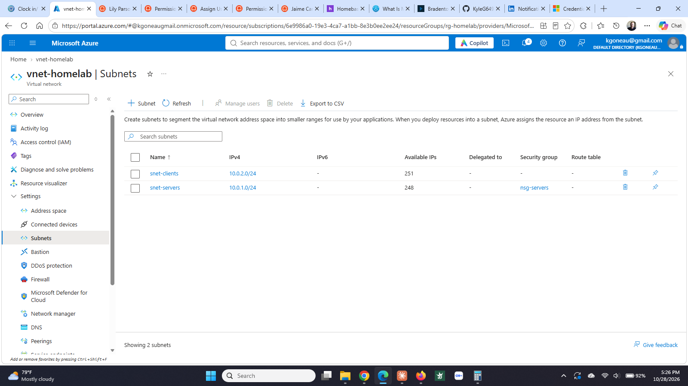
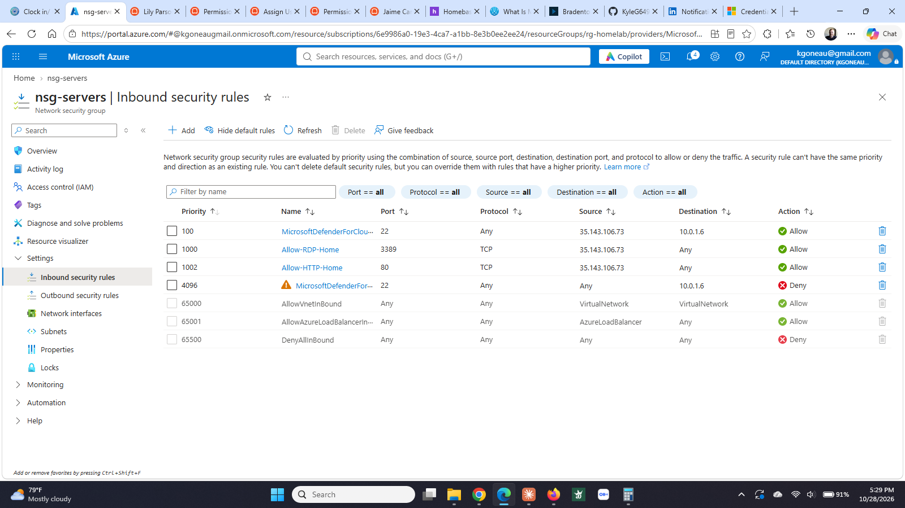
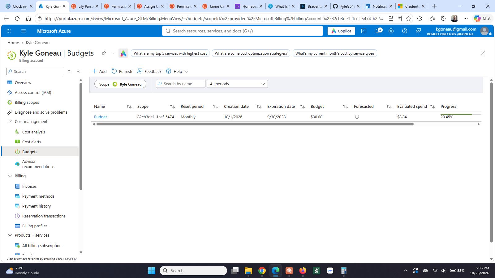

# Step 1: Foundation

**Status:** ✅ Complete (October 13, 2026)

## What I built

| Resource | Name | Details |
|----------|------|---------|
| Resource group | `rg-homelab` | East US. Holds everything in the lab. |
| Virtual network | `vnet-homelab` | Address space `10.0.0.0/16` |
| Subnet | `snet-servers` | `10.0.1.0/24`. Domain controller, member server, Linux. |
| Subnet | `snet-clients` | `10.0.2.0/24`. Workstations, later. |
| Network security group | `nsg-servers` | Attached to `snet-servers`. Two inbound rules, everything else denied. |
| Budget | `Budget` | $30/month with email alerts at 50% and 90%. |

### Inbound rules on nsg-servers

| Priority | Name | Port | Protocol | Source | Action |
|----------|------|------|----------|--------|--------|
| 100 | Allow-RDP-Home | 3389 | TCP | My public IP | Allow |
| 110 | Allow-SSH-Home | 22 | TCP | My public IP | Allow |
| 65500 | DenyAllInBound | Any | Any | Any | Deny (default) |

## Why it matters

This is the same shape a small company network takes. Servers and client machines live on separate subnets so a problem on one side can't walk straight into the other. Nothing is reachable from the internet except the two ports I opened on purpose, and only from one address. The budget alert is there because a forgotten VM can quietly cost real money.

## How I did it

1. **Resource group.** Portal → Resource groups → Create. Name `rg-homelab`, region East US.
2. **Virtual network.** Portal → Virtual networks → Create. Name `vnet-homelab`, same resource group and region. On the Address space tab set `10.0.0.0/16`, deleted the default subnet, added `snet-servers` (`10.0.1.0/24`) and `snet-clients` (`10.0.2.0/24`).
3. **Network security group.** Portal → Network security groups → Create. Name `nsg-servers`. Under Inbound security rules added the two rules above with Source = IP Addresses and my public IP from whatismyip.com. Then Subnets → Associate → `vnet-homelab` / `snet-servers`.
4. **Budget.** Cost Management + Billing → Budgets → Create. $30/month, alerts at 50% and 90% to my email.

## What went wrong

**Signed up as pay-as-you-go instead of the free trial.** I meant to use the $200 free account but the signup landed on pay-as-you-go. Microsoft support confirmed it can't be converted after the fact. Lesson: there are two buttons on the signup page, read them. Upside: I learned cost control on day one instead of month two.

**Wandered into IP address management pools.** On the VNet address space tab I clicked the wrong option and ended up in an Azure Virtual Network Manager screen asking for an IPAM pool. That's an enterprise feature for managing many networks. Closed it and used the plain "Add IPv4 address space" option.

**Searched for the NSG and got a Marketplace product.** Typing "network security group" in the portal search put a Sentinel solution for NSGs at the top. That's a paid add-on, not the NSG itself. The real one is under the **Services** heading in the results.

## What I'd do differently

- Request VM quota before building anything, not after hitting the wall.
- Read both buttons on the Azure signup page. Pay-as-you-go and the free trial look nearly identical and the choice is permanent.
- Set the budget alert first. It takes two minutes and it is the only thing standing between a forgotten VM and a surprise bill.

## Screenshots

**Virtual network and subnets.** One address space split into a server section and a client section.

**Inbound security rules.** Only my own public IP, only on the ports I opened on purpose. Everything else falls through to the default deny.

**Budget alert.** $30 a month with email alerts, because a VM left running is a quiet expense.

