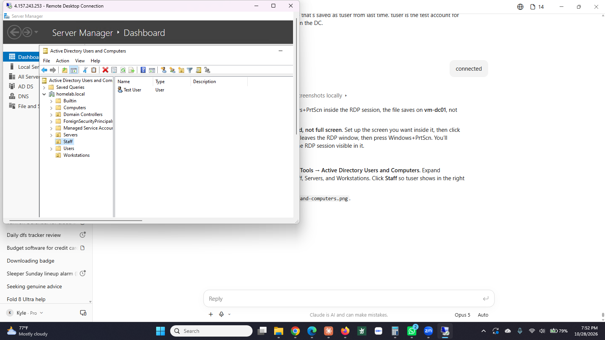
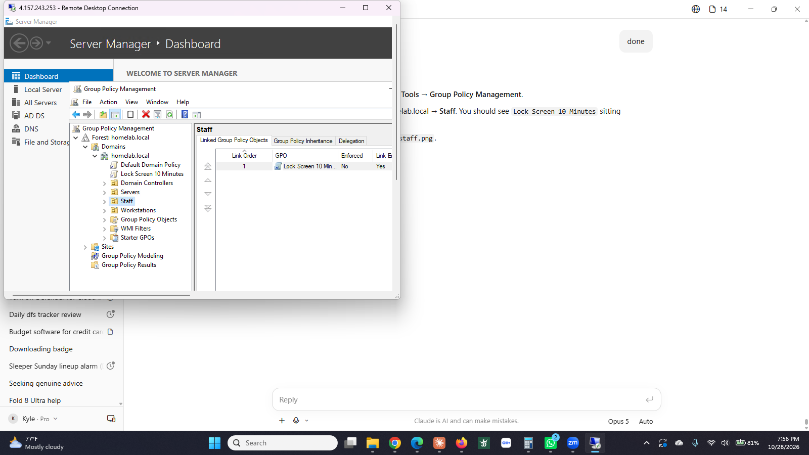
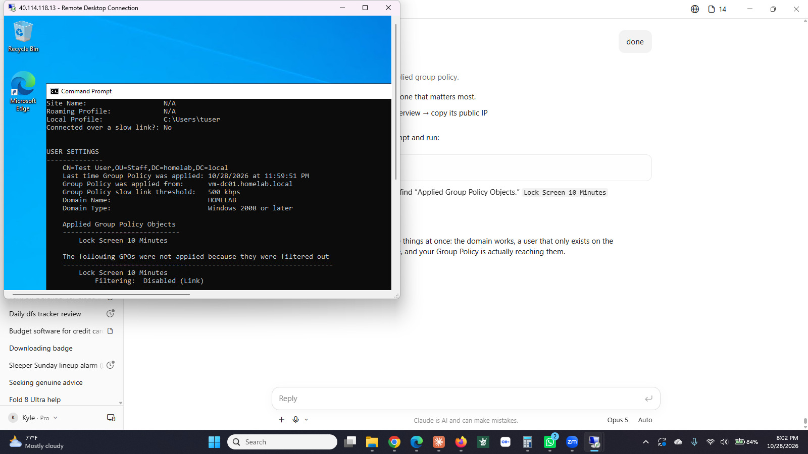

# Step 2: Windows Server domain

**Status:** ✅ Complete (October 15 to 23, 2026)

## What I built

| Resource | Name | Details |
|----------|------|---------|
| Domain controller | `vm-dc01` | Windows Server 2022, B2ls_v2, `10.0.1.4`. AD DS + DNS. Forest root for `homelab.local`. |
| Member server | `vm-member01` | Windows Server 2022, B2ls_v2, `10.0.1.5`. Joined to `homelab.local`. |
| OUs | `Staff`, `Servers`, `Workstations` | Folders for sorting users and computers. |
| Test user | `tuser` | Lives in the Staff OU. Used to prove domain logon works from another machine. |
| Group Policy | `Lock Screen 10 Minutes` | Linked to the Staff OU. Enables screen saver, password protect, 600 second timeout. |

**Proof it works:** `HOMELAB\tuser`, which exists only on the DC, logged into `vm-member01` over RDP, and `gpresult /r` on that machine shows the GPO applied from `vm-dc01.homelab.local`.

## Why it matters

A domain turns a pile of computers into a company. One directory holds every user and computer, one login works everywhere, and one rule set on the domain controller lands on every machine in a folder. Resetting passwords in AD, joining machines to the domain, and troubleshooting "why isn't this policy applying" are daily work for desktop support and sysadmins.

## How I did it

**Domain controller.** Virtual machines → Create. Windows Server 2022 Datacenter, B2ls_v2, `vnet-homelab` / `snet-servers`, public inbound ports None (the subnet NSG handles access), auto-shutdown 11 PM. RDP in. Server Manager → Add roles and features → Active Directory Domain Services. Then the notification flag → Promote this server → Add a new forest → `homelab.local` → DSRM password → Install. Reboot. Log in as `HOMELAB\kyleadmin`.

**OUs and user.** Tools → Active Directory Users and Computers. Right-click `homelab.local` → New → Organizational Unit for Staff, Servers, Workstations. Right-click Staff → New → User → Test User, logon `tuser`.

**Member server.** Second VM, same settings, same subnet. After it deployed: network interface → DNS servers → Custom → `10.0.1.4` → Save → Restart. (The new machine has to use the DC as its DNS server or it can't find the domain.) RDP in as the local admin. Server Manager → Local Server → click WORKGROUP → Change → Domain → `homelab.local` → domain admin credentials → "Welcome to the homelab.local domain" → restart. Moved the computer object from the Computers container into the Workstations OU.

**Group Policy.** Tools → Group Policy Management. Right-click the Staff OU → Create a GPO and link it → `Lock Screen 10 Minutes`. Edit → User Configuration → Policies → Administrative Templates → Control Panel → Personalization → enable Screen saver timeout (600), Enable screen saver, Password protect the screen saver. On the member server as `tuser`: `gpupdate /force`, then `gpresult /r` to confirm.

## What went wrong

**Zero VM quota on a new account.** Every B-series size showed "0 vCPUs of 0 remain" and then "NotAvailableForSubscription" in three regions. New pay-as-you-go accounts start locked. Filed a quota support request (BS and Bsv2 series, 10 vCPUs, East US). Approved in under an hour.

**VM size hidden under "Incompatible with Trusted launch."** The size picker groups sizes under headings. B2s was hidden because the VM defaulted to Trusted launch security. Switched Security type to Standard.

**Wrong username.** The Azure Basics tab defaults to `azureuser`. I set a password but didn't change the name, then couldn't log in as `kyleadmin`. Used Help → Reset password in the portal to create `kyleadmin`. Both accounts now show in AD, which is how I confirmed what happened.

**VM agent stuck "not ready" for 30 minutes.** A portal Restart cleared it in two. Restart sooner next time.

**Built the member server on the wrong network.** On the Networking tab, Azure defaulted to creating a brand new VNet (`vnet-eastus-1`, `172.16.0.0/16`) and I clicked past it. The machine landed in a different network from the DC and could never have joined. Deleted the VM, then had to delete the leftover NIC, NSG, and public IP in that order (the NSG refuses to delete while the NIC still references it). Rebuilt with `vnet-homelab` / `snet-servers` selected and the "delete NIC and IP with VM" box checked.

## Screenshots

**Active Directory Users and Computers.** The `homelab.local` domain with the Staff, Servers and Workstations OUs, and the test user inside Staff.

**Group Policy Management.** The `Lock Screen 10 Minutes` policy linked to the Staff OU. It started out linked to Workstations, where the computer object lives, and applied to nobody.

**The proof.** `gpresult /r` run as `HOMELAB\tuser` on vm-member01. One screenshot showing three things: an account that exists only on the domain controller logged into a different machine, the domain controller that authenticated it, and the Group Policy object actually applied.

