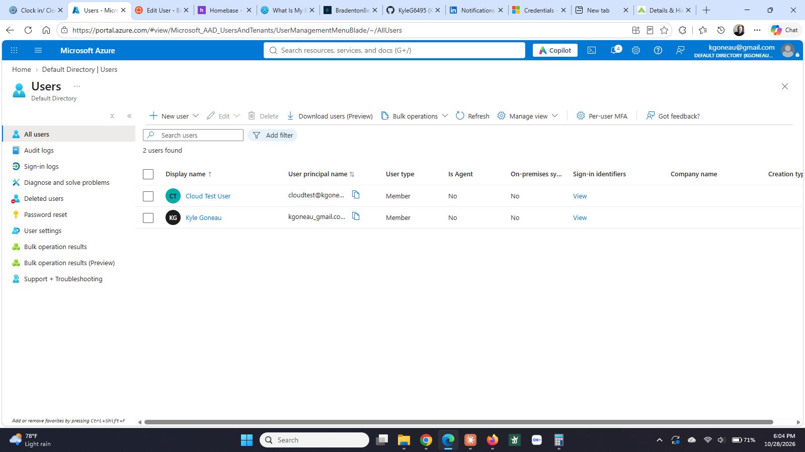
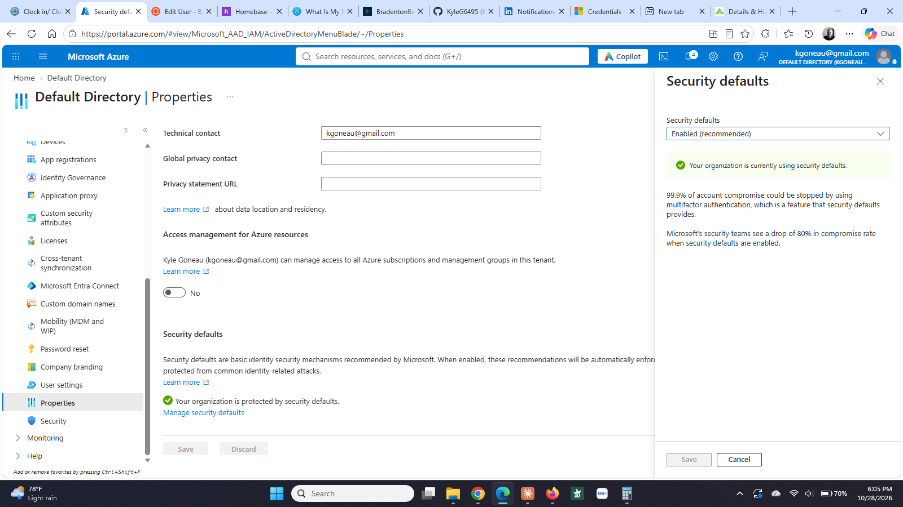

# Step 3: Cloud identity with Microsoft Entra ID

**Status:** ✅ Complete (October 27, 2026)

## What I built

| Item | Detail |
|------|--------|
| Tenant | `Default Directory`, primary domain `kgoneaugmail.onmicrosoft.com`, Entra ID Free |
| Cloud user | `cloudtest@kgoneaugmail.onmicrosoft.com` (Cloud Test User), created directly in the cloud directory |
| MFA | Enforced tenant-wide through **security defaults** |
| MFA enrollment | Registered the test user with the Microsoft Authenticator app and signed in end to end |

## Why it matters

Entra ID is the login system behind Microsoft 365 and Azure. Nearly every company that uses Outlook, Teams, or SharePoint has a tenant, and their help desk spends real time on it: creating accounts, resetting passwords, and above all re-enrolling MFA for people who got a new phone. Security defaults are what Microsoft recommends for small businesses that don't have the licensing for custom policies, and turning them on is the single highest-value security change a small shop can make.

## How I did it

**Tenant.** Portal → Microsoft Entra ID. Confirmed the existing Default Directory rather than creating a second tenant.

**Cloud user.** Manage → Users → New user → Create new user. Principal name `cloudtest`, display name Cloud Test User, password set manually.

**MFA.** Default Directory → Properties → Manage security defaults. Already Enabled, which is now the default on new tenants. This enforces MFA registration for every account in the directory.

**Proof.** Opened a private browser window, signed in to portal.azure.com as `cloudtest@kgoneaugmail.onmicrosoft.com`. The sign-in was interrupted by "Let's keep your account secure," which forced Microsoft Authenticator enrollment before it would continue. Completed the enrollment and reached the Azure portal as that user.

## What I learned

**Cloud identity and on-prem identity are two separate directories.** `tuser` exists only in Active Directory on `vm-dc01`. `cloudtest` exists only in Entra ID. Nothing connects them. The bridge in a real environment is Entra Connect, which the tenant overview flags as "Not enabled." Understanding that these are two different directories, not one, is the thing most people get wrong about hybrid identity.

**Signing in is not the same as having permissions.** After logging in, the test user saw "Don't have a subscription?" on the Azure home page. The account authenticated fine but had no access to any resources. Authentication and authorization are separate.

**Security defaults are free; conditional access is not.** Security defaults are one switch, all or nothing. Conditional access lets you write targeted rules ("require MFA only from outside the office network") but needs an Entra ID P1 license.

## What went wrong

**Nearly created a second tenant.** The first thing the portal offered was "Create a tenant," which builds a brand new directory separate from the one holding my subscription. Backed out and used the existing Default Directory.

**Could not start the Entra ID P1 trial.** The Licenses blade in the Azure portal now shows "Adding, removing, and reprocessing licensing assignments is only available within the M365 Admin Center," and the Try/Buy button is disabled. Following that link to admin.cloud.microsoft returned:

> Switch to an account that has permission. Login is not supported for consumer users without business presence.

The subscription is tied to a personal Microsoft account, and the M365 Admin Center only accepts work or school accounts. Since P1 trials now have to be started there, conditional access is out of reach on this tenant without standing up a separate work tenant. Documented rather than worked around, because the cost of the workaround outweighed the benefit for a lab.

## Screenshots

**Cloud users in Entra ID.** A directory separate from the on-prem Active Directory in `homelab.local`. Nothing syncs between the two without Entra Connect.

**Security defaults enabled.** Enforces multi-factor authentication across the whole tenant at no cost. Conditional access, the granular version, requires a paid P1 license.

