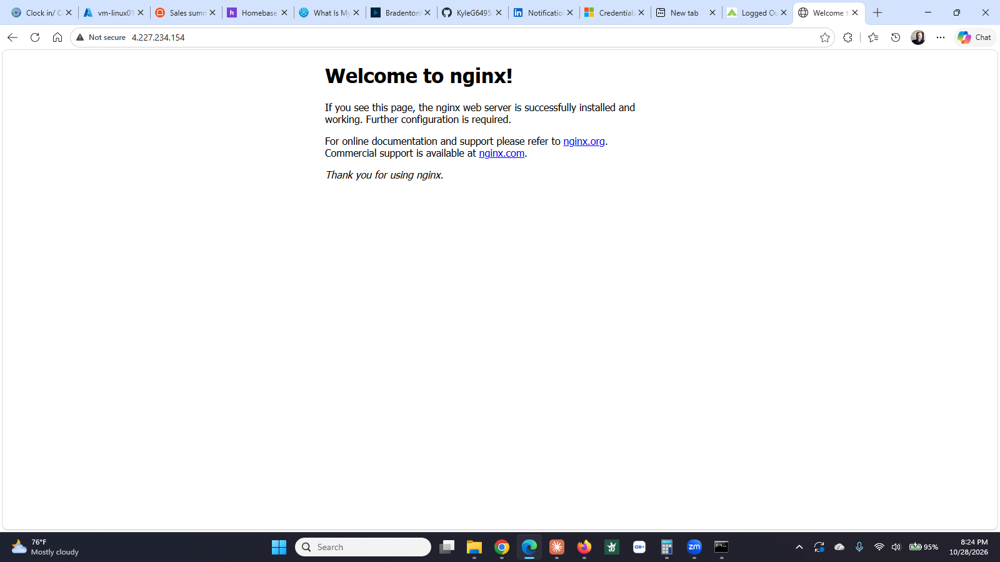
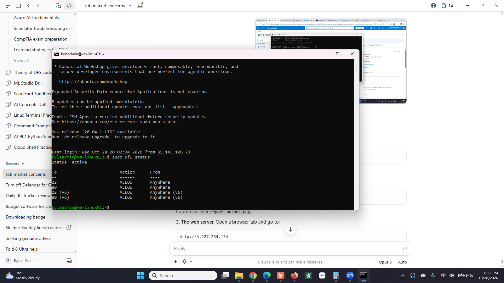
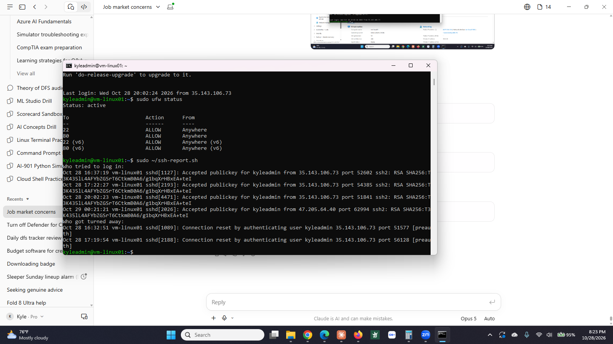

# Step 4: Linux server


**Status:** ✅ Complete (October 27 to 28, 2026)


## What I built


| Resource | Name | Details |
|----------|------|---------|
| Linux VM | `vm-linux01` | Ubuntu 24.04 LTS, B2ls_v2, `10.0.1.6`. Same subnet as the Windows servers. |
| Authentication | SSH key pair | `vm-linux01_key.pem` on my laptop. No password login. |
| Web server | nginx | Serving the default page on port 80 over the VM's public IP. |
| Host firewall | `ufw` | Enabled, allowing 22 and 80 only. |
| SSH hardening | `60-cloudimg-settings.conf` | `PasswordAuthentication no`, `PermitRootLogin no`. |
| Script | `ssh-report.sh` | Bash. Reports successful and rejected SSH attempts from the last 24 hours. |


**Proof it works:** nginx page loads in a browser over the public IP, `sudo ufw status` shows active with 22 and 80 allowed, and `ssh-report.sh` returns three accepted logins and two rejected attempts, all from my own address.


## Why it matters


Most of the infrastructure in a real environment is Linux, and it is administered over SSH with no desktop at all. This step covers the daily basics: connect with a key, edit config files from the terminal, run a service, control the host firewall, and read the logs. The two firewalls are the point worth noticing. The Azure network security group blocks traffic before it ever reaches the machine. `ufw` blocks it again on the machine itself. Either one alone is a single point of failure.


## How I did it


**VM.** Virtual machines → Create. Ubuntu Server 24.04 LTS, B2ls_v2, `vnet-homelab` / `snet-servers`. Authentication type **SSH public key**, which generates a key pair and downloads the private key once. Saved `vm-linux01_key.pem` to my user folder on Windows.


**Connect.** From Command Prompt:


```
ssh -i vm-linux01_key.pem kyleadmin@<public-ip>
```


`-i` points at the private key. The command only finds the key if the prompt is sitting in the folder that holds it, or the full path is given.


**nginx.**


```
sudo apt update
sudo apt install nginx
systemctl status nginx
```


Then added an inbound rule for port 80 on `nsg-servers` and loaded the public IP in a browser.


**ufw.**


```
sudo ufw allow 22
sudo ufw allow 80
sudo ufw enable
sudo ufw status
```


**SSH hardening.**


```
sudo nano /etc/ssh/sshd_config.d/60-cloudimg-settings.conf
```


The file already contained `PasswordAuthentication no` because the VM was built with key authentication. Added `PermitRootLogin no`. Then:


```
sudo sshd -t                  # test the config, silence means it passed
sudo systemctl restart ssh
```


Opened a second Command Prompt and connected again before closing the first one. Never close the working session until a new one is proven.

## Screenshots

**nginx serving over the public IP.** A web server running on a machine with no desktop, reachable only from the one address the NSG allows.



**`ufw status`.** The host firewall, allowing only 22 and 80. This runs on the machine itself, underneath the Azure network security group. Either layer alone is a single point of failure.



**`ssh-report.sh`.** The Bash script reading the SSH journal and splitting it into accepted logins and rejected attempts. Every entry is my own address, because port 22 has never been open to anyone else.


