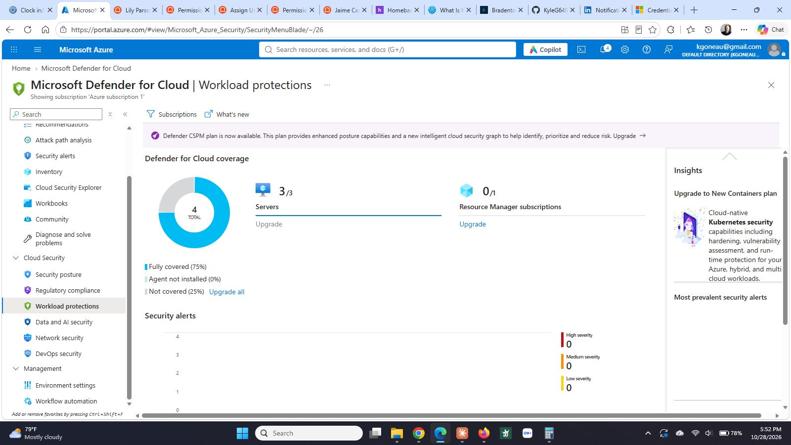
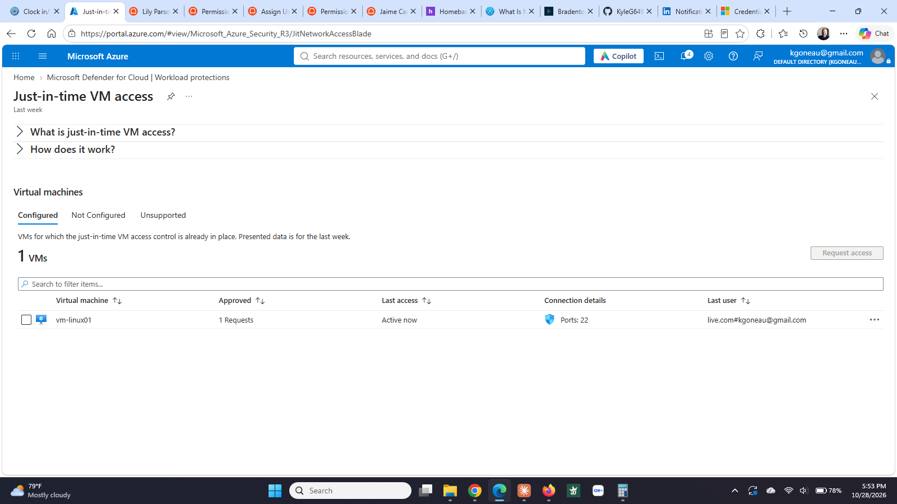

# Step 5: Security posture and just-in-time access


**Status:** ✅ Complete (October 28, 2026) — evaluated under the 30-day trial, scheduled to be turned off before it bills


## What I built


| Item | Detail |
|------|--------|
| Defender for Servers | Plan 2, enabled on the subscription. Plan 2 is the tier that includes just-in-time access. |
| JIT policy | `vm-linux01`, port 22, maximum request duration 3 hours. |
| NSG change | Deleted the standing `Allow-SSH-Home` rule so the port is closed by default. |


**Proof it works:** with the VM running, `ssh` timed out. After requesting access through Defender, the same command connected. The port closes itself when the three hours are up.


## Why it matters


Before this, port 22 was open to my home IP permanently. That is better than open to the world, but the door is still unlocked the other 23 hours of the day, and the rule has to be hand-edited every time my public IP changes.


Just-in-time flips the default. The port is closed, including to me. Access is requested, granted for a set window, and revoked automatically. The attack surface exists only while someone is actually using it, and there is an audit trail of who asked and when.


It also solves a problem that had broken my lab three separate times: my public IP changes depending on whether I am working from home or from the restaurant, and every change meant editing NSG rules by hand. A JIT request uses whatever IP I am on at the time.


## How I did it


**Enabling the plan.** The portal would not do it. Environment settings listed the subscription but the row was not clickable. Workload protections showed an "Enable Microsoft Defender for Cloud" button that bounced back to the onboarding page, which claimed everything was already onboarded. The subscription Security blade offered "Try it free for the first 30 days" and did the same thing. Three routes, three dead ends.


Checked Access control (IAM) first to rule out permissions. Confirmed Owner on the subscription, so it was not that.


Did it from Azure Cloud Shell instead:


```
az security pricing create -n VirtualMachines --tier standard --subplan P2
```


Response confirmed `"pricingTier": "Standard"`, `"subPlan": "P2"`, `"freeTrialRemainingTime": "30 days"`. Workload protections then showed Servers 3/3 covered.


**Creating the JIT policy.** Defender had not yet scanned the environment, so the Just-in-time page listed no eligible VMs under Configured, Not Configured, or Unsupported. The page header still read "Last week." Rather than wait hours for the next assessment, wrote the policy straight to the management API:


```
az rest --method put \
  --url "https://management.azure.com/subscriptions/<sub-id>/resourceGroups/rg-homelab/providers/Microsoft.Security/locations/eastus/jitNetworkAccessPolicies/default?api-version=2020-01-01" \
  --body '{"kind":"Basic","properties":{"virtualMachines":[{"id":"<vm-resource-id>","ports":[{"number":22,"protocol":"*","allowedSourceAddressPrefix":"*","maxRequestAccessDuration":"PT3H"}]}]}}'
```


vm-linux01 appeared under Configured immediately.


**Removing the standing rule.** JIT adds its own deny rule to the NSG, but at a high priority number. My `Allow-SSH-Home` rule sat at priority 110, so it was evaluated first and kept port 22 open regardless of what JIT wanted. Deleted that rule. Only then was the port actually closed.


**Testing.** With the VM running, `ssh -i vm-linux01_key.pem kyleadmin@<ip>` timed out. Then Defender for Cloud → Workload protections → Just-in-time VM access → Configured → vm-linux01 → Request access, port 22, My IP, 3 hours. The same ssh command connected.

## Screenshots

**Defender for Servers coverage.** All three VMs under Plan 2 after enabling it from the command line, which the portal would not do.



**Just-in-time access configured.** Port 22 on vm-linux01 is closed by default and opened only on request. The row shows an approved request active at the time of the screenshot.


