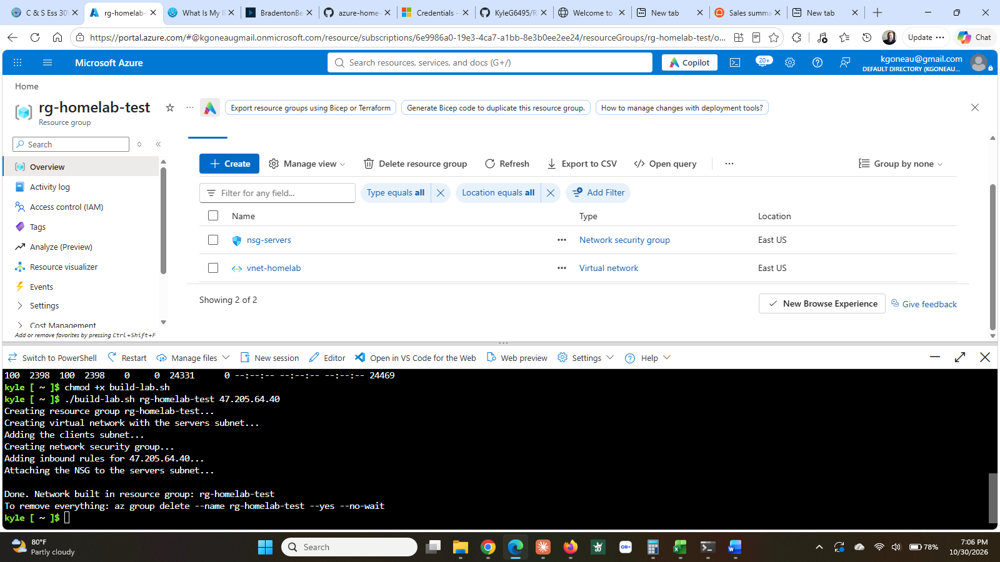
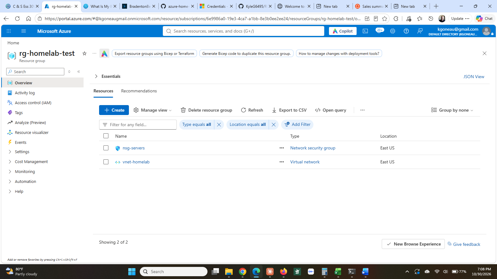

# Step 8: Automation

**Status:** ✅ Complete (October 30, 2026)

## What I built

[`build-lab.sh`](build-lab.sh) — a Bash script that builds the lab network from nothing using the Azure CLI.

```
./build-lab.sh <resource-group-name> <your-public-ip>
```

It creates the resource group, the virtual network, both subnets, the network security group with all three inbound rules, and the association between the NSG and the servers subnet. Roughly forty seconds, against about an hour of clicking through the portal the first time.

It deliberately does not create VMs. Those are slow and billable, and the network is the part that benefits from being repeatable.

**Proof it works:** run against a fresh resource group `rg-homelab-test`, it produced a complete second copy of the network alongside the real one. Verified in the portal, then deleted.

## Why it matters

Clicking through a portal produces one environment. A script produces as many as you need, identically, and the file itself is the documentation — it cannot drift from what was actually built, because it is what builds it.

The practical arguments:

- **Consistency.** No forgotten step at 11pm, no subnet off by one.
- **Speed.** Forty seconds instead of an hour.
- **Review.** The whole environment is a text file in version control. Someone can read the diff before it is applied.
- **Recovery.** If the lab is deleted, rebuilding it is one command rather than an afternoon.

This is also the step that changes what the rest of the repo means. Everything before it demonstrates that the environment was built carefully. This one demonstrates it can be built repeatably.

## How it works

The script takes two arguments and refuses to run without them:

```bash
RG="$1"
MYIP="$2"

if [ -z "$RG" ] || [ -z "$MYIP" ]; then
  echo "Usage: ./build-lab.sh <resource-group-name> <your-public-ip>"
  exit 1
fi
```

`$1` and `$2` are whatever was typed after the script name. `-z` tests for empty. Without that check, running it bare would create a resource group with no name and fail halfway through with something unhelpful.

`set -e` at the top stops the script the moment any command fails. Without it, a failure partway through would be followed by every remaining command running against a half-built environment.

Every `az` call uses `--output none`, because the default is a page of JSON per command and the useful output is the progress lines the script prints itself.

The last line prints the teardown command:

```
To remove everything: az group delete --name rg-homelab-test --yes --no-wait
```

That is there on purpose. The Defender trial in step 5 was a lesson in working out how to remove something before creating it. A script that creates resources should tell you how to undo them.

## What I'd do differently

- Look up the current public IP inside the script rather than passing it in. It is the argument most likely to be wrong, and it changes every time I move between locations.
- Add a check for whether the resource group already exists, so running it twice does not produce confusing partial errors.
- Learn Bicep or Terraform next. A shell script lists commands in order; those tools describe the desired end state and work out the steps, which handles re-running and partial changes far better. The Azure portal offers to export a resource group as either, which is a reasonable way in.

## Screenshots

**The script running.** Every stage printed as it completed, start to finish in under a minute.



**What it produced.** A new resource group containing a virtual network and a network security group, built entirely by the script and verified in the portal before being deleted.


