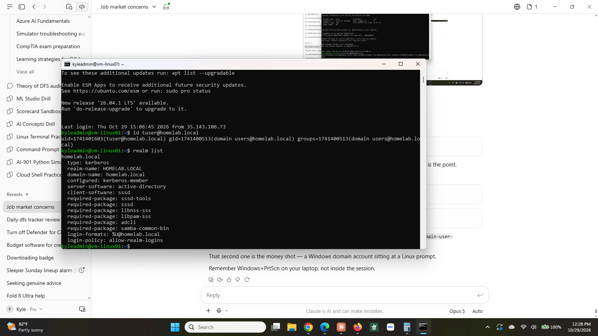
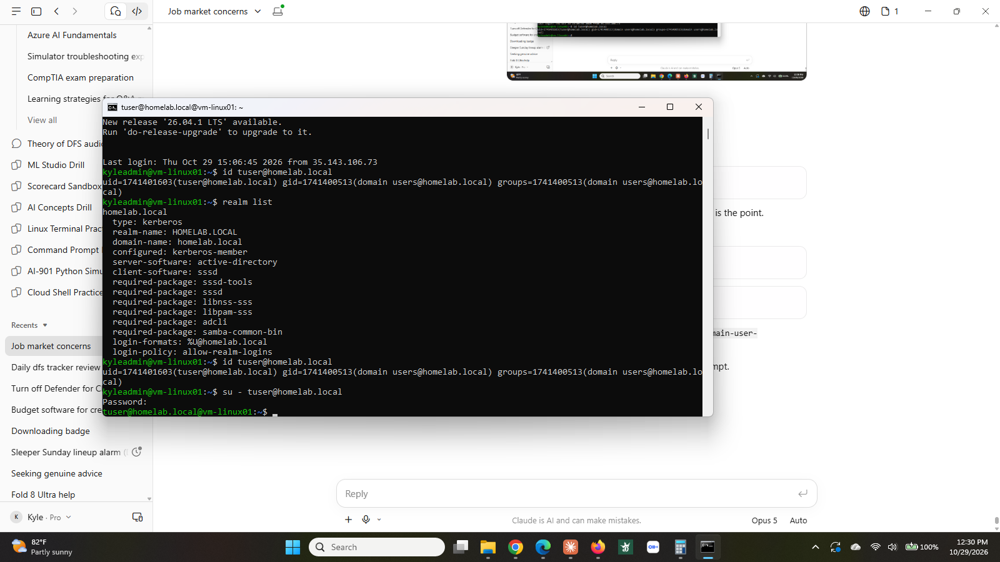

# Step 9: Joining Linux to the Windows domain

**Status:** ✅ Complete (October 29, 2026)

## What I built

| Item | Detail |
|------|--------|
| Domain membership | `vm-linux01` joined to `homelab.local` as a Kerberos member. |
| Directory client | `sssd`, answering every user and group lookup from Active Directory. |
| Home directories | `pam_mkhomedir` enabled, so a domain user gets `/home/<user>@homelab.local` on first login. |
| DNS routing | `~homelab.local` routed to the domain controller, written to `/etc/systemd/resolved.conf.d/homelab.conf` so it survives reboots. |
| DNS forwarder | `168.63.129.16` added on `vm-dc01` so the domain controller can answer for the public internet. |

**Proof it works:** `realm list` reports `configured: kerberos-member`. `id tuser@homelab.local` returns a UID and Domain Users membership for an account that exists only on the domain controller. `su - tuser@homelab.local` authenticates against Active Directory and lands in a freshly created home directory. All of it still works after a reboot.

## Why it matters

Most environments are not all Windows or all Linux. They are both, and the question of how a person signs into each is a real operational problem. Without this, every Linux box keeps its own local accounts: separate passwords, no central disable when someone leaves, no single place to audit who has access.

Joining Linux to Active Directory solves that. One account, one password, one place to revoke it. This is what identity management actually looks like in a mixed shop, and it is the piece most home labs skip because Windows and Linux get built in separate corners and never introduced.

## How I did it

**DNS first.** Pointed the VM's network interface at `10.0.1.4` in the portal, then restarted. Nothing else works until Linux can find the domain.

**Packages.**

```
sudo apt install -y realmd sssd sssd-tools adcli samba-common-bin oddjob oddjob-mkhomedir krb5-user
```

The Kerberos installer prompts for a realm: `HOMELAB.LOCAL`, uppercase.

**Discover, then join.**

```
realm discover homelab.local
sudo realm join -U kyleadmin homelab.local
realm list
```

`discover` is read-only and confirms the domain is reachable and is Active Directory. `join` does the work and prints nothing on success.

**Home directories.** The join does not enable them.

```
sudo pam-auth-update --enable mkhomedir
```

**Verify.**

```
id tuser@homelab.local
su - tuser@homelab.local
```

Note the login format is `user@domain`, not `DOMAIN\user`. `realm list` prints the expected format under `login-formats`.

## What went wrong

**`.local` is not an ordinary DNS suffix.** `resolvectl query homelab.local` failed with "No appropriate name servers or networks for name found," even with the DNS server set correctly. systemd-resolved reserves `.local` for mDNS, the zero-configuration protocol used by printers and media devices, and refuses to send those names to a unicast DNS server. mDNS was disabled on this host, so the query had nowhere to go at all.

Fixed by adding a routing domain that forces the suffix to the real resolver:

```
sudo resolvectl domain eth0 reddog.microsoft.com '~homelab.local'
```

This is a good argument for not naming an Active Directory domain `.local` in the first place. Microsoft stopped recommending it years ago.

**That fix broke all other DNS.** Setting the domain list explicitly removed `eth0` as the default route for lookups, so `apt` could no longer resolve `azure.archive.ubuntu.com`. The error was identical to the first one, which made it look like the same problem rather than a new one I had just caused.

Fixed by adding `~.`, the catch-all routing domain:

```
sudo resolvectl domain eth0 reddog.microsoft.com '~homelab.local' '~.'
```

**The domain controller had no forwarder.** Pointing Linux at `10.0.1.4` for DNS meant the domain controller was now answering every lookup, including ones for the public internet, and it had nothing configured to pass those along. Added `168.63.129.16`, Azure's platform DNS, under DNS Manager → server Properties → Forwarders. This is standard for any DC running DNS, and it was only exposed once something started relying on it for general resolution.

**The resolver fix was not persistent.** `resolvectl domain` sets runtime state and is lost on reboot, which would have silently broken the domain join at the worst possible moment. Written to a drop-in instead:

```
/etc/systemd/resolved.conf.d/homelab.conf

[Resolve]
Domains=~homelab.local
```

Then verified by actually rebooting and re-running `id tuser@homelab.local`, rather than assuming.

**No home directory on first login.** `su` warned "cannot change directory to /home/tuser@homelab.local." `oddjob-mkhomedir` was installed but the PAM module was never enabled. `sudo pam-auth-update --enable mkhomedir` switched it on.

## What I'd do differently

- Do not name an Active Directory domain with a `.local` suffix. It collides with mDNS and costs an hour on every Linux client.
- Configure the DNS forwarder on the domain controller when the DC is built, not when something finally depends on it.
- When a fix produces a new failure with the same error text, suspect the fix before suspecting the environment.
- Write resolver settings to a drop-in file from the start. Runtime-only configuration that disappears on reboot is worse than no configuration, because it works long enough to be trusted.

## Screenshots

**Domain membership.** `realm list` showing `configured: kerberos-member`. Before the join this line read `configured: no`.



**A domain account on a Linux host.** `id` resolves a user that exists only in Active Directory, including Domain Users membership. `su` then authenticates that account against the domain controller and the shell prompt changes to the domain user.


