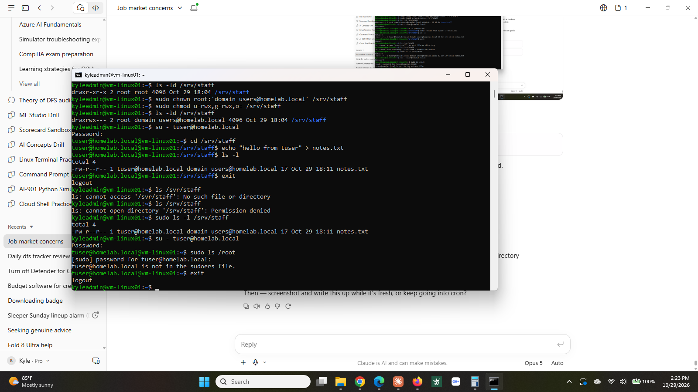
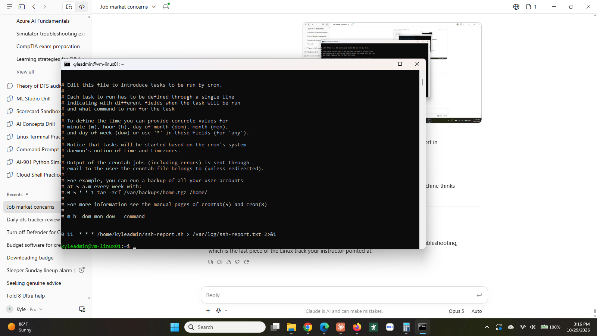

# Step 10: Linux permissions and scheduled jobs

**Status:** ✅ Complete (October 29, 2026)

## What I built

| Item | Detail |
|------|--------|
| Shared directory | `/srv/staff`, owned by `root`, group `domain users@homelab.local`, mode `rwxrwx---`. |
| Access control | Membership is decided by Active Directory, not by anything configured on the Linux host. |
| Scheduled job | Root crontab entry running `ssh-report.sh` daily at 11:00 UTC, output to `/var/log/ssh-report.txt`. |

**Proof it works:** `tuser@homelab.local` can enter `/srv/staff` and create files in it. `kyleadmin`, a local account on the same machine, gets `Permission denied` on the same path, and succeeds only with `sudo`. `tuser` attempting `sudo` is refused with "is not in the sudoers file." The cron job was first set to run every minute to confirm it fires, then moved to its real schedule.

## Why it matters

Permissions are the most commonly asked Linux topic in interviews and the most commonly misunderstood one on the job. "Permission denied" is one of the highest volume tickets in any support queue, and resolving it means knowing which of three sets applies to the person in front of you.

The shared directory also demonstrates the point of the domain join in step 9. Access to this folder is not managed on the Linux box at all. Add someone to the right group in Active Directory and they get in. Remove them and they do not. One place to grant, one place to revoke, which is what auditors actually ask about.

Scheduled jobs matter for the same reason automation does generally. A report that requires a person to remember to run it is a report that stops existing the first busy week.

## The permission model

Every file carries ten characters:

```
d rwx rwx ---
| |   |   |
| |   |   everyone else
| |   group
| owner
file type (d for directory, - for a regular file)
```

`r` read, `w` write, `x` execute. On a directory, `x` means the ability to enter it.

Two things that are easy to get wrong:

**A directory is a gate.** `notes.txt` inside `/srv/staff` is world-readable (`-rw-r--r--`), but nobody outside the group can read it, because they cannot enter the directory it lives in. Checking a file's own permissions without checking the path above it gives the wrong answer.

**Root ignores all of it.** The permission bits are not a wall for root, which is exactly why `PermitRootLogin no` was set in step 4.

## How I did it

**The shared directory.**

```
sudo mkdir /srv/staff
sudo chown root:'domain users@homelab.local' /srv/staff
sudo chmod u=rwx,g=rwx,o= /srv/staff
ls -ld /srv/staff
```

The group name is quoted because it contains a space. `chown` takes `owner:group`. The result:

```
drwxrwx--- root domain users@homelab.local /srv/staff
```

**Testing it from both sides.**

```
su - tuser@homelab.local
cd /srv/staff
echo "hello from tuser" > notes.txt     # works
exit

ls /srv/staff                            # Permission denied
sudo ls -l /srv/staff                    # works
```

**Checking who can escalate.**

```
getent group sudo
```

Returned `sudo:x:27:kyleadmin`. One account on this host can borrow root's privileges. `tuser` cannot, and the attempt is logged.

**The scheduled job.**

```
sudo crontab -e
```

First entry, deliberately aggressive, to confirm cron was actually firing:

```
* * * * * /home/kyleadmin/ssh-report.sh > /tmp/report-test.txt 2>&1
```

Waited a minute, confirmed the file appeared with real content, then changed it to the real schedule:

```
0 11 * * * /home/kyleadmin/ssh-report.sh > /var/log/ssh-report.txt 2>&1
```

The five fields are minute, hour, day of month, month, day of week. `*` means every value.

It runs under root's crontab because `journalctl` needs privileges to read the authentication log.

## What went wrong

**Edited the schedule but not the destination.** Changed `* * * * *` to `0 11 * * *` and left the output pointing at `/tmp/report-test.txt`. `/tmp` is cleared on reboot, so the report would have quietly stopped existing. Caught it by running `crontab -l` and reading the whole line instead of assuming the edit was complete.

**Dropped `2>&1` while editing.** Without it, a failing script writes an empty file and no explanation. A scheduled job that fails silently is worse than one that never ran, because the empty output looks like a result.

**Server time is UTC.** Scheduling for `0 7` would have run the job at 3am Eastern. The machine's clock is not the admin's clock, and cron does not care what time zone you live in.

**`ls /svr/staff` instead of `/srv/staff`.** Worth recording because the error text is the useful part: "No such file or directory" means the path is wrong, "Permission denied" means the path is right and the access is not. Two different problems, two different fixes.

## What I'd do differently

- Run `crontab -l` after every edit. Reading the stored line back is the only way to know what was actually saved.
- Set a new cron job to an aggressive schedule first, confirm it fires, then move it to the real time. Waiting a day to find out it never ran is a wasted day.
- Check `date` on the server before scheduling anything.
- Read the error text before changing anything. "No such file" and "Permission denied" send you in completely different directions.

## Screenshots

**Permissions in both directions.** `tuser` writes to `/srv/staff`; `kyleadmin` is denied on the same path and succeeds only with `sudo`; `tuser` is refused sudo entirely.



**The scheduled job.** `crontab -l` showing the daily entry under root.


