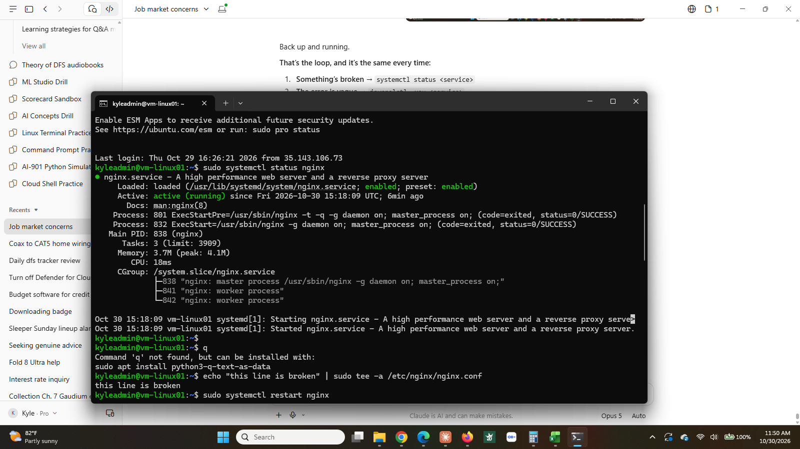
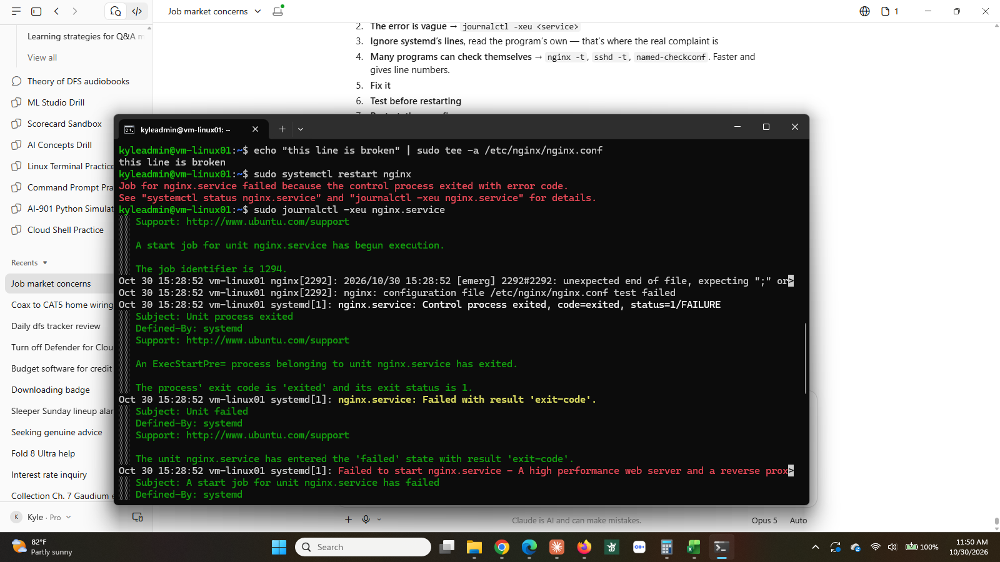
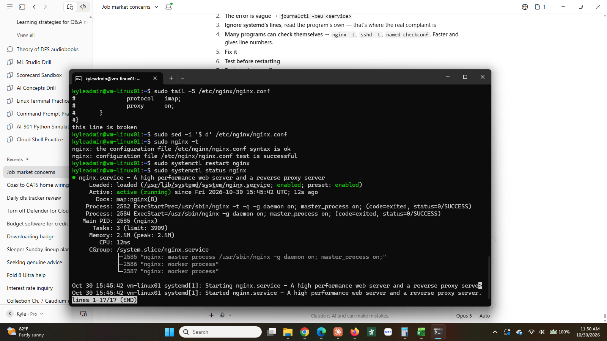

# Step 11: Service troubleshooting

**Status:** ✅ Complete (October 30, 2026)

## What I did

Broke nginx deliberately, then diagnosed and fixed it using only the logs, without knowing in advance what the fault was going to look like from the system's side.

| Stage | Command | Result |
|-------|---------|--------|
| Confirm healthy | `systemctl status nginx` | `active (running)`, two workers |
| Introduce the fault | `echo "this line is broken" \| sudo tee -a /etc/nginx/nginx.conf` | invalid directive appended to the main config |
| Observe the failure | `systemctl restart nginx` | `Job for nginx.service failed because the control process exited with error code` |
| Read the journal | `journalctl -xeu nginx.service` | `[emerg] unexpected end of file, expecting ";" or "}"` |
| Narrow it down | `nginx -t` | `/etc/nginx/nginx.conf:85` |
| Confirm the cause | `tail -5 /etc/nginx/nginx.conf` | the bad line, visible at the end of the file |
| Fix | `sed -i '$ d' /etc/nginx/nginx.conf` | last line removed |
| Verify before acting | `nginx -t` | `syntax is ok`, `test is successful` |
| Restart and confirm | `systemctl restart nginx` then `systemctl status nginx` | `active (running)` |

## Why it matters

Installing software is the easy part and it happens once. Everything after that is figuring out why something that worked yesterday doesn't work today, usually while somebody waits.

The skill is not memorising error messages. It is knowing the order to look in, and knowing which output to ignore.

## The method

**1. `systemctl status <service>`** tells you whether it is running and shows the last few log lines.

**2. `journalctl -xeu <service>`** is the full log for that unit. `-u` filters to the unit, `-e` jumps to the newest entries, `-x` adds explanatory text.

**3. Ignore systemd's lines.** This is the part worth internalising. In the journal output above, most of the text comes from `systemd[1]` and says variations of "the thing I started exited with an error." systemd has no idea *why*. The useful line comes from the process itself, prefixed `nginx[2292]`, and it is specific: unexpected end of file, expecting `;` or `}`.

**4. Use the program's own config test where one exists.** `nginx -t`, `sshd -t`, `named-checkconf`, `apachectl configtest`. These are faster than reading the journal and they report a line number, which the journal did not.

**5. Fix, test, then restart.** Running `nginx -t` before `systemctl restart` means a second mistake is caught before it takes the service down again.

## What I noticed

**The first error is almost never the real one.** `systemctl restart` returned a message that described the shape of the failure and then told me where to look. Treating that as the answer, rather than as a pointer, is how people end up searching the internet for a generic string instead of reading the specific one two layers down.

**A config test gives a line number and the journal does not.** Both said the same thing about the fault. Only `nginx -t` said `conf:85`. When a service has a test mode, that is the first thing to run, not the last.

**systemd's output is the loudest and the least useful.** Roughly 25 of the 30 lines in the journal came from systemd and none of them identified the cause. Learning to skip straight to the application's own lines cut the problem down to one sentence.

**Order matters.** Test, then restart. The same discipline as step 4, where restarting `sshd` with a broken config would have locked me out of the machine entirely. Here the stakes were lower, but the habit is the same one.

## What I'd do differently

- Run the config test first, before reading the journal at all, whenever the service has one.
- Check `tail` on the config file before assuming the fault is complicated. Recent edits are at the end, and recent edits are usually the cause.
- Resist the urge to restart repeatedly hoping for a different result. Nothing changed between attempts, so nothing will.

## Screenshots

**Healthy, then broken.** The service running normally, the bad line appended, and the restart refusing.

**The failure and the journal.** systemd reports that something failed; the journal shows nginx's own complaint about the config file.

**Diagnosis and fix.** `tail` exposes the bad line, `sed` removes it, `nginx -t` confirms the config is valid, and the service comes back up.

