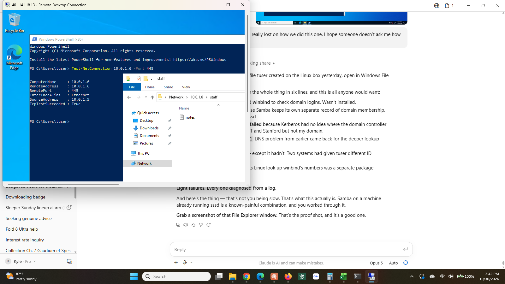

# Step 12: Samba share with Active Directory access control

**Status:** ✅ Complete (October 30, 2026)

## What I built

A folder on the Linux server that Windows machines can open as a network share, with access decided by Active Directory group membership rather than by anything configured locally.

| Item | Detail |
|------|--------|
| Share | `[staff]` → `/srv/staff`, the same directory from step 10 |
| Server role | `member server`, `security = ads`, workgroup `HOMELAB` |
| Authentication | `winbind`, against `homelab.local` |
| ID mapping | `idmap config HOMELAB : backend = sss`, so Samba uses the IDs sssd already assigned |
| Name resolution | `winbind` added to `passwd` and `group` in `/etc/nsswitch.conf` |
| Firewall | port 445 opened in `ufw` |

**Proof it works:** from `vm-member01`, `\\10.0.1.6\staff` opens in File Explorer after authenticating as `HOMELAB\tuser`, and shows `notes.txt` — a file created by that same domain account directly on the Linux server the day before.

## Why it matters

A file share is one of the most common things a server does, and in a mixed environment it is also where Windows and Linux have to actually agree about identity. Getting a share working is easy. Getting it to honour Active Directory group membership is the part that matters, because that is what lets access be granted and revoked in one place.

It also stacks directly on earlier steps. The directory permissions were set in step 10, the domain join in step 9. Samba contributes the Windows-facing protocol and nothing else: it authenticates the user against AD, then the existing filesystem permissions decide what happens.

## How I did it

```
sudo apt install -y samba
sudo cp /etc/samba/smb.conf /etc/samba/smb.conf.backup
```

Global section:

```
workgroup = HOMELAB
server role = member server
security = ads
realm = HOMELAB.LOCAL
kerberos method = system keytab
idmap config * : backend = tdb
idmap config * : range = 3000-7999
idmap config HOMELAB : backend = sss
idmap config HOMELAB : range = 1000000-2000000000
```

Share definition:

```
[staff]
   comment = Staff share
   path = /srv/staff
   browseable = yes
   read only = no
```

No `valid users` line. The directory is already `drwxrwx---` with the group set to the Active Directory group, so the filesystem decides access and Samba does not need its own list.

Supporting pieces:

```
sudo apt install -y winbind libnss-winbind
sudo net ads join -U kyleadmin
sudo systemctl enable --now winbind
sudo ufw allow 445/tcp
```

## What went wrong

Eight separate failures. Each one is listed with the error that identified it, because the error text is the useful part.

**1. Windows could not access the share at all.** Service was running, port 445 was listening, `Test-NetConnection` from the Windows side returned `TcpTestSucceeded: True`. Network and service were both fine, which narrowed it to authentication. Samba's per-client log named the cause outright:

```
check_winbind_security: winbindd not running - but required as domain member
NT_STATUS_NO_LOGON_SERVERS
```

`winbind` is a separate package from `samba` and is not pulled in automatically.

**2. winbind would not start.** `journalctl` showed only systemd's generic failure. The answer was in `/var/log/samba/log.winbindd`:

```
Could not fetch our SID - did we join?
```

The machine *was* joined, in step 9, but that join was performed by `realmd` and recorded for `sssd`. Samba keeps its own record of domain membership and had never been told.

**3. `net ads join` could not find the domain controller.** `failed to find DC for domain HOMELAB`. Pointing it directly at the DC with `-S 10.0.1.4` produced a different error, `failed to lookup DC info ... over rpc`, which confirmed it could reach the machine but not complete the exchange.

**4. Kerberos had no idea where the KDC was.**

```
kinit: Cannot find KDC for realm "HOMELAB.LOCAL"
```

`/etc/krb5.conf` had `default_realm = HOMELAB.LOCAL` at the top and a `[realms]` section containing MIT, Stanford, CMU and Toronto — Ubuntu's stock example file, untouched. `realm join` never edited it because sssd does not read it. Added the realm and the domain mapping, and `kinit` succeeded.

**5. The join still failed, and it was the `.local` problem again.** Samba locates a DC through DNS SRV records. Querying one by hand returned the same message that had cost an hour in step 9:

```
resolvectl service _ldap._tcp.dc._msdcs.homelab.local
Resolve call failed: No appropriate name servers or networks for name found
```

The persistent fix written in step 9 set the routing domain globally, which covered `homelab.local` but not these deeper service records. Re-applying it at the interface level resolved the SRV record immediately, and `net ads join` then succeeded.

**6. Windows reported "The specified network password is not correct."** It was correct. The log showed authentication had already passed and the failure came one step later:

```
add_local_groups: SID S-1-5-21-... -> getpwuid(3000) failed, is nsswitch configured?
```

**7. Two ID systems disagreed.** `wbinfo -i HOMELAB\tuser` returned UID `3000` (winbind's own range) with GID `1741400513` (sssd's). Two directories were independently inventing Linux IDs for the same account. Fixed by pointing Samba at sssd for this domain with `idmap config HOMELAB : backend = sss`. The `sss.so` module ships with Samba, despite the package commonly named for it not existing on Ubuntu.

**8. `getpwuid(3000)` still failed after adding `winbind` to `nsswitch.conf`.** The entry was correct but pointed at a module that was not installed. `libnss-winbind` is packaged separately from `winbind`. Installing it was the last piece.

## What I'd do differently

- Do not name an Active Directory domain with a `.local` suffix. Three of these eight failures trace back to that single decision.
- Verify a "permanent" DNS fix against the exact query that will be used, not a simpler one. The step 9 fix passed its test and still did not cover what Samba needed.
- Pick one directory client per host. sssd and winbind both work; running both means reconciling two sets of IDs, and that reconciliation caused failures 6 through 8.
- When Windows says the password is wrong, read the server log before retyping it. Authentication had succeeded every time.
- Check that an `nsswitch.conf` entry has a matching library installed. A line referring to a missing module fails silently.

## Screenshots

**The share open on Windows.** `\\10.0.1.6\staff` in File Explorer on vm-member01, authenticated as `HOMELAB\tuser`, showing a file that account created on the Linux server the previous day.


