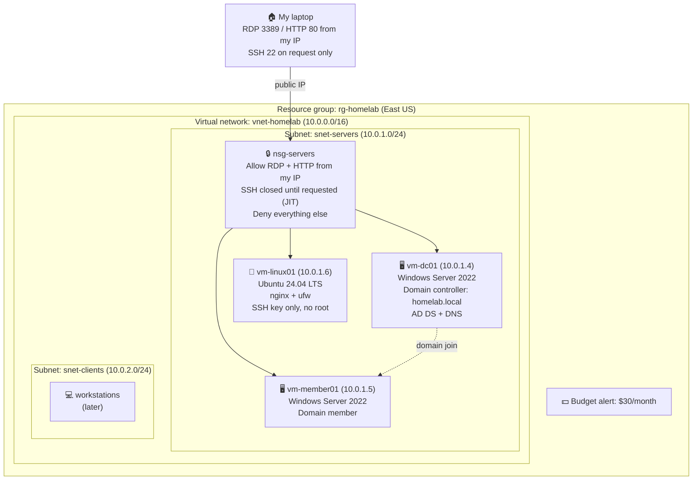

# Azure Home Lab


A working Azure environment I'm building from scratch while completing the IT Security and Administration program at MyComputerCareer. Every step is written up as I go: what I built, why it matters, what broke, and how I fixed it.

**Goal:** a small, hardened company network in Azure that covers the day-to-day skills of a systems administrator and the foundation for AZ-104 and AZ-500.

## Progress

| # | Step | What it proves | Status |
|---|------|----------------|--------|
| 1 | [Foundation](01-foundation/) | Networking, segmentation, firewall rules, cost control | ✅ Done |
| 2 | [Windows Server domain](02-windows-domain/) | Active Directory, DNS, Group Policy, domain join | ✅ Done |
| 3 | [Cloud identity](03-entra-id/) | Entra ID, cloud users, MFA enrollment | ✅ Done |
| 4 | [Linux](04-linux/) | Ubuntu, nginx, SSH hardening, ufw, Bash | ✅ Done |
| 5 | [Security posture](05-defender/) | Defender for Servers, just-in-time VM access | ✅ Done |
| 6 | Backup and recovery | Azure Backup, test restore | 🔧 Next |
| 7 | Monitoring | Log Analytics, alert rules | ⬜ |
| 8 | Automation | PowerShell and Bash scripts | ⬜ |

## Architecture



## What's in here

```
azure-home-lab/
  01-foundation/        resource group, VNet, subnets, NSG, budget
  02-windows-domain/    Windows Server 2022 VM, domain controller, AD, GPO
  03-entra-id/          Entra ID tenant, cloud users, MFA
  04-linux/             Ubuntu VM, nginx, ufw, SSH hardening, Bash script
  05-defender/          Defender for Servers Plan 2, just-in-time VM access
  06-backup/
  07-monitoring/
  08-scripts/
```

Each folder has a `README.md` with the write-up and a `screenshots/` folder.

## How I write these up

Every step follows the same four parts:

1. **What I built** and why it matters in a real environment.
2. **How I did it**, with enough detail that someone could repeat it.
3. **What went wrong** and how I fixed it. This is the part that matters most.
4. **What I'd do differently** next time.

## Lessons so far

- Microsoft locks new pay-as-you-go accounts out of most VM sizes until you file a quota request. Mine was approved in under an hour, but you have to know to ask.
- The VM size picker hides sizes under "Size not available" and "Insufficient quota" groups. Read the group headings before assuming a size doesn't exist.
- A VM shut down from inside Windows still bills. Only **Stop (deallocate)** in the portal stops the meter.
- `ipconfig` gives you a private address. Firewall rules need your public one.
- If your public IP changes (different location, ISP lease), RDP fails with error 0x204. Check the NSG rule first.
- Azure's default VM username is `azureuser`. If you don't change it on the Basics tab, that's your login.
- The Networking tab on Create VM defaults to a brand new VNet. Pick yours or the machine lands in the wrong network.
- A new domain member needs the DC as its DNS server before it can join.
- Domain users can't RDP to a server until they're in its Remote Desktop Users group.
- User-side Group Policy follows the user's OU, not the computer's.
- Entra ID and on-prem Active Directory are separate directories. Nothing syncs between them without Entra Connect.
- Security defaults enforce MFA for a whole tenant for free. Conditional access needs a paid P1 license.
- A personal Microsoft account can't open the M365 Admin Center, which is now the only place to start a P1 trial.
- A wrong filename in Linux does not error. `nano` just opens a new empty file and quietly waits. Tab completion is the early warning.
- Linux is case sensitive. `grep accepted` finds nothing when the log says `Accepted`.
- An elevated Command Prompt on Windows starts in `System32`, not your user folder, so a relative path to an SSH key will not resolve.
- Test an SSH config with `sshd -t` and prove a new session works before closing the old one. SSH is how you get in, so breaking it locks you out.
- Two firewalls is not redundancy for its own sake. The NSG stops traffic before the VM reaches it; `ufw` stops it on the VM.
- The Azure portal is not always the shortest path. Three separate blades refused to enable Defender for Servers; one `az` command did it.
- NSG rules are evaluated lowest priority number first. A standing allow rule will silently defeat a just-in-time policy that looks correctly configured.
- A connection timeout proves nothing if the machine might be powered off. Confirm the VM is running before calling it a successful block.
- Defender only shows resources it has assessed, and assessment can lag hours behind enabling the plan. The management API does not wait.
- Work out how to remove a paid feature before enabling the trial. Turning off just-in-time access leaves its deny rule behind in the NSG.

## Background

Twenty-three years running a business taught me how to keep things working when it counts. This lab is me putting that same habit into Azure. Resume and the rest of the story are on [LinkedIn](https://www.linkedin.com/in/kyle-goneau-4728a187/).
