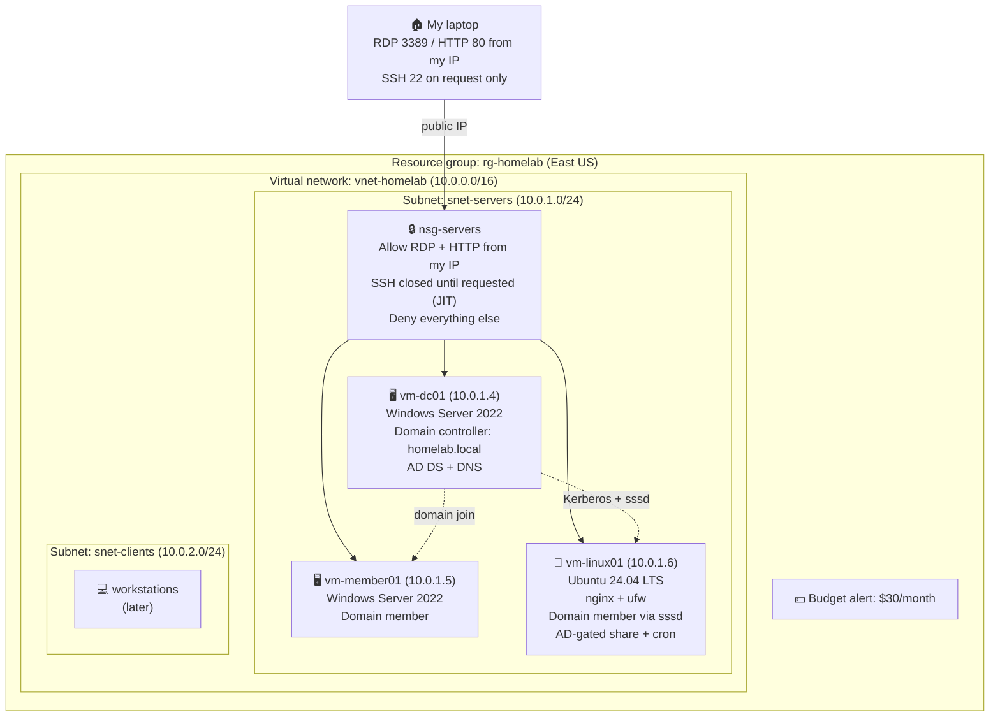

# Azure Home Lab


A working Azure environment I'm building from scratch while completing the IT Security and Administration program at MyComputerCareer. Every step is written up as I go: what I built, why it matters, what broke, and how I fixed it.

**Goal:** a small, hardened company network in Azure that covers the day-to-day skills of a systems administrator and the foundation for AZ-104 and AZ-500.

## Progress

| # | Step | What it proves | Status |
|---|------|----------------|--------|
| 1 | [Foundation](01-foundation/) | Networking, segmentation, firewall rules, cost control | ✅ Done |
| 2 | [Windows Server domain](02-windows-domain/) | Active Directory, DNS, Group Policy, domain join | ✅ Done |
| 3 | [Cloud identity](03-entra-id/) | Entra ID, cloud users, MFA enrollment | ✅ Done |
| 4 | [Linux](04-linux/) | Ubuntu, nginx, SSH hardening, ufw, Bash | ✅ Done |
| 5 | [Security posture](05-defender/) | Defender for Servers, just-in-time VM access | ✅ Done |
| 9 | [**Linux domain join**](09-linux-domain-join/) | **realmd, sssd, Kerberos, one identity across Windows and Linux** | ✅ Done |
| 10 | [Permissions and cron](10-linux-users-cron/) | File permissions, group-based access, scheduled jobs | ✅ Done |
| 11 | [Troubleshooting](11-troubleshooting/) | Reading logs, diagnosing a failed service, config tests | ✅ Done |
| 12 | [**Samba AD share**](12-samba-ad-share/) | **Windows file share on Linux, access controlled by Active Directory** | ✅ Done |
| 6 | Backup and recovery | Azure Backup, test restore | 🔧 Next |
| 7 | Monitoring | Log Analytics, alert rules | ⬜ |
| 8 | [**Automation**](08-scripts/) | **Bash + Azure CLI script that builds the whole network in one command** | ✅ Done |

## Architecture



## What's in here

```
azure-home-lab/
  01-foundation/           resource group, VNet, subnets, NSG, budget
  02-windows-domain/       Windows Server 2022 VM, domain controller, AD, GPO
  03-entra-id/             Entra ID tenant, cloud users, MFA
  04-linux/                Ubuntu VM, nginx, ufw, SSH hardening, Bash script
  05-defender/             Defender for Servers Plan 2, just-in-time VM access
  09-linux-domain-join/    realmd, sssd, Kerberos, Linux joined to Active Directory
  10-linux-users-cron/     file permissions, AD-group-gated share, cron
  11-troubleshooting/      journalctl, config tests, diagnosing a dead service
  12-samba-ad-share/       Samba, winbind, Kerberos, AD-controlled Windows file share
  06-backup/
  07-monitoring/
  08-scripts/              build-lab.sh, builds the network from one command
```

Each folder has a `README.md` with the write-up and a `screenshots/` folder.

## How I write these up

Every step follows the same four parts:

1. **What I built** and why it matters in a real environment.
2. **How I did it**, with enough detail that someone could repeat it.
3. **What went wrong** and how I fixed it. This is the part that matters most.
4. **What I'd do differently** next time.

## Lessons so far

- Microsoft locks new pay-as-you-go accounts out of most VM sizes until you file a quota request. Mine was approved in under an hour, but you have to know to ask.
- The VM size picker hides sizes under "Size not available" and "Insufficient quota" groups. Read the group headings before assuming a size doesn't exist.
- A VM shut down from inside Windows still bills. Only **Stop (deallocate)** in the portal stops the meter.
- `ipconfig` gives you a private address. Firewall rules need your public one.
- If your public IP changes (different location, ISP lease), RDP fails with error 0x204. Check the NSG rule first.
- Azure's default VM username is `azureuser`. If you don't change it on the Basics tab, that's your login.
- The Networking tab on Create VM defaults to a brand new VNet. Pick yours or the machine lands in the wrong network.
- A new domain member needs the DC as its DNS server before it can join.
- Domain users can't RDP to a server until they're in its Remote Desktop Users group.
- User-side Group Policy follows the user's OU, not the computer's.
- Entra ID and on-prem Active Directory are separate directories. Nothing syncs between them without Entra Connect.
- Security defaults enforce MFA for a whole tenant for free. Conditional access needs a paid P1 license.
- A personal Microsoft account can't open the M365 Admin Center, which is now the only place to start a P1 trial.
- A wrong filename in Linux does not error. `nano` just opens a new empty file and quietly waits. Tab completion is the early warning.
- Linux is case sensitive. `grep accepted` finds nothing when the log says `Accepted`.
- An elevated Command Prompt on Windows starts in `System32`, not your user folder, so a relative path to an SSH key will not resolve.
- Test an SSH config with `sshd -t` and prove a new session works before closing the old one. SSH is how you get in, so breaking it locks you out.
- Two firewalls is not redundancy for its own sake. The NSG stops traffic before the VM reaches it; `ufw` stops it on the VM.
- The Azure portal is not always the shortest path. Three separate blades refused to enable Defender for Servers; one `az` command did it.
- NSG rules are evaluated lowest priority number first. A standing allow rule will silently defeat a just-in-time policy that looks correctly configured.
- A connection timeout proves nothing if the machine might be powered off. Confirm the VM is running before calling it a successful block.
- Defender only shows resources it has assessed, and assessment can lag hours behind enabling the plan. The management API does not wait.
- Work out how to remove a paid feature before enabling the trial. Turning off just-in-time access leaves its deny rule behind in the NSG.
- systemd-resolved reserves `.local` for mDNS and will not send those names to a real DNS server. Naming an Active Directory domain `.local` costs an hour on every Linux client.
- Setting a routing domain explicitly removes the interface's default route for DNS. Add `~.` or everything else stops resolving.
- A domain controller running DNS needs a forwarder. The gap only shows up once something starts relying on it for public names.
- `resolvectl domain` is runtime only. Configuration that disappears on reboot is worse than none, because it works long enough to be trusted.
- An SSH config file (`~/.ssh/config`) turns a long command into `ssh linux01`. Notepad will save it as `config.txt` and SSH will ignore it.
- A directory is a gate. A world-readable file inside a locked folder is still unreachable, so checking a file's own permissions without checking the path above it gives the wrong answer.
- "No such file or directory" and "Permission denied" are different problems. The first means the path is wrong, the second means the access is.
- Servers run on UTC. Scheduling a job for 7am without checking the machine's clock runs it at 3 in the morning.
- Set a new cron job to fire every minute first, confirm it runs, then move it to the real schedule. And always `crontab -l` afterwards to read back what was actually saved.

- The first error message is a pointer, not an answer. `systemctl` tells you something failed; the journal tells you why.
- In a service journal, most lines come from systemd and say nothing useful. The application's own lines are the ones that name the fault.
- A config test (`nginx -t`, `sshd -t`) gives a line number that the journal does not. Run it first.
- Check `tail` on a config file before assuming the problem is complicated. The most recent edit is at the end, and it is usually the cause.

- Two directory clients on one host means two sets of Linux user IDs for the same account, and they will disagree. Pick sssd or winbind, not both.
- An `nsswitch.conf` entry pointing at a module that is not installed fails silently. `winbind` and `libnss-winbind` are separate packages.
- "The specified network password is not correct" from Windows does not mean the password is wrong. Read the server's log before retyping it.
- Verify a permanent DNS fix against the exact query that will use it. A fix that resolves `homelab.local` may still not resolve `_ldap._tcp.dc._msdcs.homelab.local`.
- Samba keeps its own record of domain membership, separate from the one `realmd` creates for sssd. Joining once does not join both.

- A script that creates resources should print the command that removes them. Working out the teardown afterwards is how trials turn into bills.
- `set -e` stops a script at the first failure. Without it, everything after a broken step runs against a half-built environment.
- Check required arguments at the top and exit with a usage message. A script that fails halfway with a confusing error is worse than one that refuses to start.
- Pasting a long block into a terminal mangles it. Put the file in version control and `curl` it down instead.

## Background

Twenty-three years running a business taught me how to keep things working when it counts. This lab is me putting that same habit into Azure. Resume and the rest of the story are on [LinkedIn](https://www.linkedin.com/in/kyle-goneau-4728a187/).
