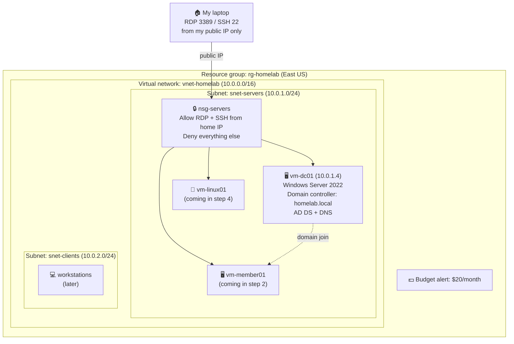

# Azure Home Lab


A working Azure environment I'm building from scratch while completing the IT Security and Administration program at MyComputerCareer. Every step is written up as I go: what I built, why it matters, what broke, and how I fixed it.

**Goal:** a small, hardened company network in Azure that covers the day-to-day skills of a systems administrator and the foundation for AZ-104 and AZ-500.

## Progress

| # | Step | What it proves | Status |
|---|------|----------------|--------|
| 1 | [Foundation](01-foundation/) | Networking, segmentation, firewall rules, cost control | ✅ Done |
| 2 | [Windows Server domain](02-windows-domain/) | Active Directory, DNS, Group Policy, domain join | 🔧 In progress |
| 3 | Cloud identity | Entra ID, MFA, conditional access | ⬜ |
| 4 | Linux | Ubuntu, web server, SSH hardening, ufw, Bash | ⬜ |
| 5 | Security posture | Defender for Cloud, just-in-time VM access | ⬜ |
| 6 | Backup and recovery | Azure Backup, test restore | ⬜ |
| 7 | Monitoring | Log Analytics, alert rules | ⬜ |
| 8 | Automation | PowerShell and Bash scripts | ⬜ |

## Architecture



## What's in here

```
azure-home-lab/
  01-foundation/        resource group, VNet, subnets, NSG, budget
  02-windows-domain/    Windows Server 2022 VM, domain controller, AD, GPO
  03-entra-id/
  04-linux/
  05-defender/
  06-backup/
  07-monitoring/
  08-scripts/
```

Each folder has a `README.md` with the write-up and a `screenshots/` folder.

## How I write these up

Every step follows the same four parts:

1. **What I built** and why it matters in a real environment.
2. **How I did it**, with enough detail that someone could repeat it.
3. **What went wrong** and how I fixed it. This is the part that matters most.
4. **What I'd do differently** next time.

## Lessons so far

- Microsoft locks new pay-as-you-go accounts out of most VM sizes until you file a quota request. Mine was approved in under an hour, but you have to know to ask.
- The VM size picker hides sizes under "Size not available" and "Insufficient quota" groups. Read the group headings before assuming a size doesn't exist.
- A VM shut down from inside Windows still bills. Only **Stop (deallocate)** in the portal stops the meter.
- `ipconfig` gives you a private address. Firewall rules need your public one.
- If your public IP changes (different location, ISP lease), RDP fails with error 0x204. Check the NSG rule first.
- Azure's default VM username is `azureuser`. If you don't change it on the Basics tab, that's your login.

## Background

Twenty-three years running a business taught me how to keep things working when it counts. This lab is me putting that same habit into Azure. Resume and the rest of the story are on [LinkedIn](https://www.linkedin.com/in/kyle-goneau-4728a187/).
