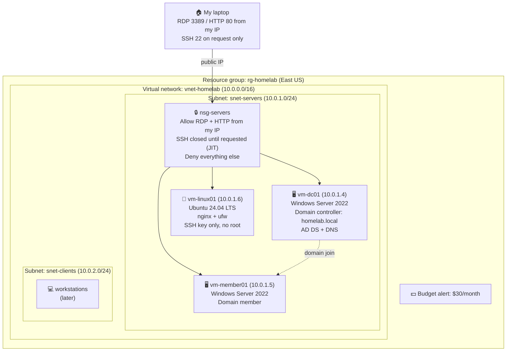

# Azure Home Lab


A working Azure environment I'm building from scratch while completing the IT Security and Administration program at MyComputerCareer. Every step is written up as I go: what I built, why it matters, what broke, and how I fixed it.


**Goal:** a small, hardened company network in Azure that covers the day-to-day skills of a systems administrator and the foundation for AZ-104 and AZ-500.


## Progress


| # | Step | What it proves | Status |
|---|------|----------------|--------|
| 1 | [Foundation](01-foundation/) | Networking, segmentation, firewall rules, cost control | ✅ Done |
| 2 | [Windows Server domain](02-windows-domain/) | Active Directory, DNS, Group Policy, domain join | ✅ Done |
| 3 | [Cloud identity](03-entra-id/) | Entra ID, cloud users, MFA enrollment | ✅ Done |
| 4 | [Linux](04-linux/) | Ubuntu, nginx, SSH hardening, ufw, Bash | ✅ Done |
| 5 | [Security posture](05-defender/) | Defender for Servers, just-in-time VM access | ✅ Done |
| 6 | Backup and recovery | Azure Backup, test restore | 🔧 Next |
| 7 | Monitoring | Log Analytics, alert rules | ⬜ |
| 8 | Automation | PowerShell and Bash scripts | ⬜ |


## Architecture





## What's in here


```
azure-home-lab/
  01-foundation/        resource group, VNet, subnets, NSG, budget
  02-windows-domain/    Windows Server 2022 VM, domain controller, AD, GPO
  03-entra-id/          Entra ID tenant, cloud users, MFA
  04-linux/             Ubuntu VM, nginx, ufw, SSH hardening, Bash script
  05-defender/          Defender for Servers Plan 2, just-in-time VM access
  06-backup/
  07-monitoring/
  08-scripts/
```


Each folder has a `README.md` with the write-up and a `screenshots/` folder.
